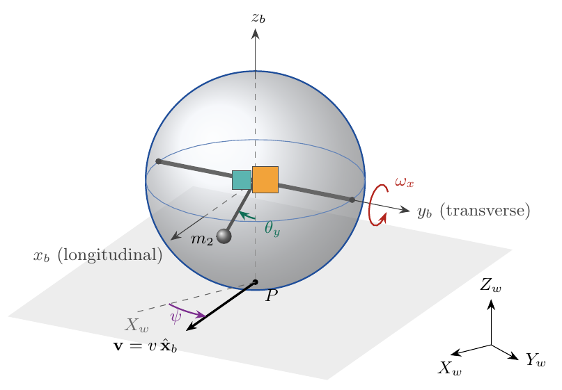
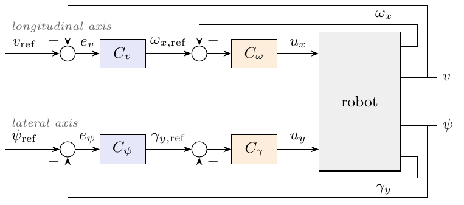

# Decoupled Modeling and Cascaded Control of a Two-Degrees of Freedom Pendulum-Driven Spherical Robot

Simulink model accompanying the paper

> *Decoupled Modeling and Cascaded Control of a Two-Degrees of Freedom Pendulum-Driven Spherical Robot* (authors, venue, year — to be added)

<p align="center">
  
</p>

## Video of the real robot

<!-- Replace VIDEO_ID with the YouTube video ID -->
[](https://www.youtube.com/watch?v=VIDEO_ID)

## Contents

| File | Description |
|---|---|
| `simulink_model/spherical_robot_2DOF.slx` | Simulink model with the decoupled model and the multibody (Simscape) model of the robot, controlled by the same cascaded controller |
| `docs/` | Figures used in this README |

The model contains two plants that are simulated in parallel with the same
references and controllers:

- **System model**: the decoupled model of the paper, i.e. two planar
  Lagrangian models (longitudinal and lateral axis) closed by the heading
  kinematics,
  $\dot\psi = (v/r)\tan\varphi_y$, $\dot X = v\cos\psi$, $\dot Y = v\sin\psi$.
- **Simscape model**: a three-dimensional multibody model of the shell and
  the two-axis pendulum with compliant ground contact and friction, in which
  turning emerges from the dynamics.

## Control structure

<p align="center">
  
</p>

- **Longitudinal axis:** speed loop $C_v$ → shaft-rate loop $C_\omega$ → motor torque $u_x$
- **Lateral axis:** heading loop $C_\psi$ → relative pendulum roll loop $C_\gamma$ → servo torque $u_y$

## Requirements

- MATLAB / Simulink **R2026b** (the model can be saved for older releases with *Save As*)
- Simscape
- Simscape Multibody

## Running the model

1. Open `simulink_model/spherical_robot_2DOF.slx`.
2. Select the reference with the manual switches at the top level of the model
   (speed step, tilt step, heading step, heading ramp, circle, figure-eight).
3. Run the simulation. The scopes and XY graphs show the responses and paths
   of both models.


## Citation

If you use this model, please cite the paper:

```bibtex
@article{TODO,
  title   = {Decoupled Modeling and Cascaded Heading Control of a
             Pendulum-Driven Spherical Robot},
  author  = {TODO},
  journal = {TODO},
  year    = {TODO}
}
```

## License

MIT, see [LICENSE](LICENSE).

